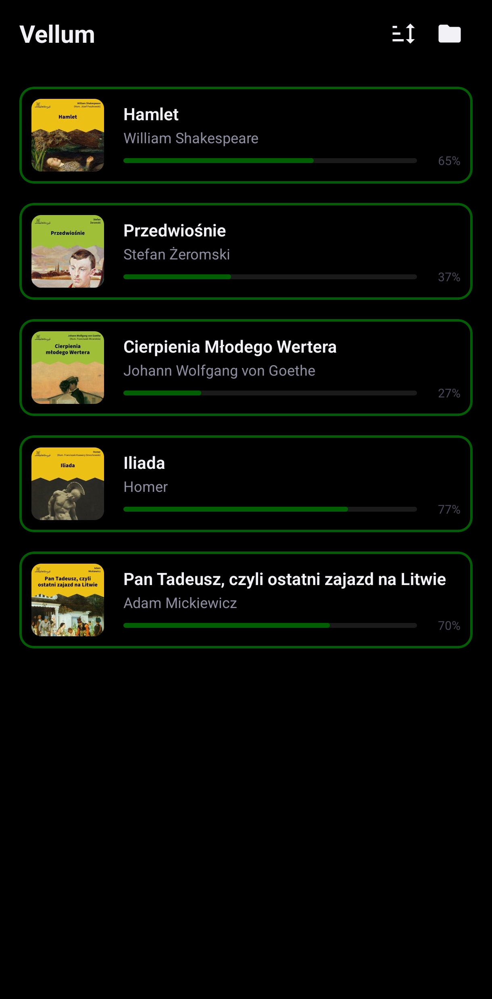
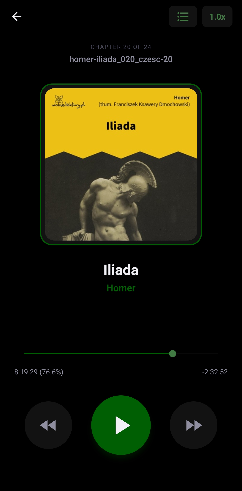

# Vellum

An Android local audiobook player. Point Vellum at a folder of audiobooks (one subfolder per book,
named `Title [Author]`), and it builds your library, remembers per-book progress, and plays chapters
in the background with system media controls and full playback-rate control.

<p align="center">
  
  &nbsp;&nbsp;&nbsp;
  
</p>

## Features

- **Folder-based library** - pick a base folder once; each subfolder becomes one audiobook.
- **Smart scanning** - titles/authors parsed from `Title [Author]` folder names, natural-number
  chapter sorting, audio files discovered by extension.
- **Library sorting** - order by recently played (default), title, or author, each ascending or
  descending; the preference persists across restarts. Recency reuses the last-played timestamps
  already stored with book progress.
- **Resume anywhere** - book progress (chapter, position, rate) persisted to MMKV every 5s, on
  pause, and on backgrounding.
- **Full-screen player** - seek bar, ±60s rewind/forward with chapter-boundary wrapping, playback
  rates from 0.5x–3.0x, and a chapter list with tap-to-jump.
- **Adjustable cover focus** - long-press the cover to vertically re-crop it (persisted per book);
  applied consistently in the library, the player, and the media notification artwork.
- **System media controls** - background playback through a native media session (notification and
  lock screen): play/pause/stop, previous/next chapter, ±15s skips, and seek-scrubber support,
  with artwork, title, author, and position kept in sync.

## Tech Stack

- **Expo SDK 55** + React Native 0.83 + React 19 (Android-only; requires a dev build)
- **TypeScript** with strict typechecking
- **MobX** (`mobx-react-lite`) for state management
- **expo-audio** for playback (new API - `createAudioPlayer` / `player.replace`)
- **expo-media-control** for the system media session (yarn-patched for a reliable background
  lifecycle)
- **expo-image-manipulator** for cropping notification artwork to the cover focus
- **react-native-mmkv** for synchronous local persistence
- **React Navigation** (native stack), **react-native-gesture-handler** + **reanimated** for gestures

## Requirements

- Node `v24.13.1` (see `.nvmrc`)
- Yarn 4
- Android SDK / emulator or device

## Getting Started

```sh
# Install dependencies
yarn

# Run a development build (generates the native android/ directory on first run)
yarn android

# Or start the dev server against an existing dev build
yarn start
```

> The app depends on native modules (MMKV JSI, expo-audio) so it must run on a **dev build**, not
> Expo Go. `android/` and `expo-env.d.ts` are generated by `expo run:*` and are gitignored.

## Commands

| Command            | Description                                          |
| ------------------ | ---------------------------------------------------- |
| `yarn start`       | Start the dev server (dev client)                    |
| `yarn android`     | Run a debug native build (`expo run:android`)        |
| `yarn iba`         | Build and install a release build                    |
| `yarn typecheck`   | `tsc --noEmit` - run before pushing                  |
| `yarn lint`        | ESLint (import order + prettier enforced)            |
| `yarn lint --fix`  | Auto-fix import sorting and formatting               |
| `yarn format`      | Prettier write                                       |

## Project Structure

```
app/
  components/   Presentational UI (BookCard, NowPlaying, PlayerProgress, SortModal,
                CoverFocusModal, RateModal, ...)
  consts/       Shared constants, split per domain (theme, sizes, playback, files, storage, ...)
  providers/    StoreProvider - creates the single RootStore and wraps the app
  router/       Routes.tsx - the native stack navigator
  screens/      Screen components (Library, Player, Chapters, FolderSetup)
  stores/       MobX stores (RootStore, PlayerStore, UIStore)
  types/        Domain + navigation types (LibraryTypes, RouterTypes)
  utils/        localStore (MMKV), scanner, sorting, progress, coverArtwork, mediaControls,
                time, chapterName
images/         Screenshots used in this README
App.tsx         App shell: splash, StoreProvider, NavigationContainer, initial route
```

## Architecture

- **Entry**: `App.tsx` reads the persisted base folder synchronously from MMKV to choose the
  initial route (`FolderSetup` on first run, otherwise `Library`), then renders the navigation tree
  inside the MobX `StoreProvider`.
- **State**: `PlayerStore` owns all playback state (book, chapter, position, rate, durations);
  `UIStore` owns persisted UI preferences (per-book cover focus, library sort). Screens consume
  store slices via `usePlayerStore()` / `useUIStore()` and are wrapped in `observer()`.
  `RootStore` links the two (`player.root`) and its `bootstrap()` hydrates persisted state;
  `dispose()` tears down listeners and reactions.
- **Persistence**: synchronous MMKV through `app/utils/localStore.ts`. Book progress is a
  whole-blob `Record<bookId, BookProgress>` map, written on a 5s interval, on pause, on background,
  and before switching books. Cover focus and the library sort preference are separate keys,
  written through synchronously on every change.
- **Background work**: `PlayerStore.setup()` wires MobX `reaction`s - one persists progress, one
  keeps the system media controls in sync (metadata including the focus-cropped artwork, plus
  playback state). Metadata is also re-synced explicitly after seeks, chapter changes, and
  cover-focus edits; native calls are timeout-guarded so a hung seek can never wedge the store.
- **Path aliases**: per-folder aliases under `app/` (`@components/*`, `@stores/*`, `@utils/*`, ...),
  resolved at runtime via `experiments.tsconfigPaths`.
